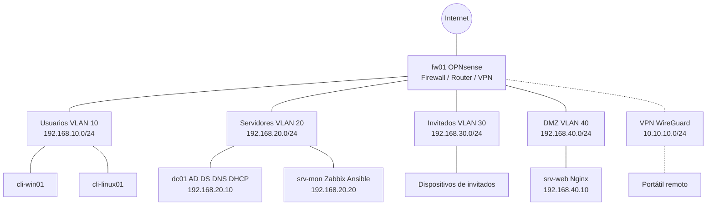

# Diagrama de red

GitHub renderiza este diagrama automáticamente. Cuando termines, exporta también una versión en imagen (por ejemplo con draw.io) y guárdala en `evidencias/`.

## Flujos permitidos (resumen)
| Origen | Destino | Servicio |
|---|---|---|
| Usuarios | dc01 | DNS, Kerberos, LDAP, SMB |
| Usuarios | srv-web | HTTPS |
| Usuarios | Internet | Todo |
| Servidores | Internet | HTTP/HTTPS (actualizaciones) |
| srv-mon | srv-web / dc01 | SSH, agente Zabbix |
| Invitados | Internet | Todo (aislados del resto) |
| DMZ | Internet | HTTP/HTTPS (actualizaciones) |
| VPN | Usuarios, Servidores | Solo lo necesario |
